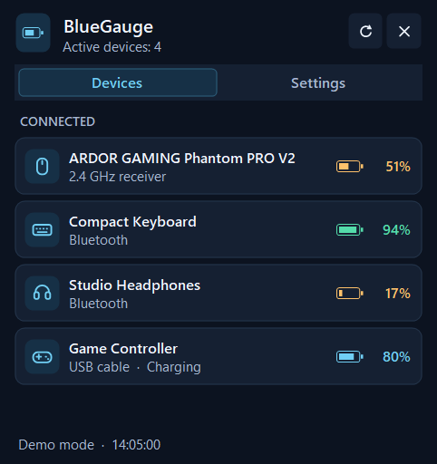

# BlueGauge

**Live battery readings for supported wireless devices in the Windows tray.**

[Download for Windows x64](https://github.com/BilliBobba/BlueGauge/releases/latest) · [All releases](https://github.com/BilliBobba/BlueGauge/releases) · [Русская версия](README.ru.md) · [MIT](LICENSE)

## Download and run

Get the portable ZIP from the [latest release](https://github.com/BilliBobba/BlueGauge/releases/latest), extract it, and run `BlueGauge.exe`. No separate .NET installation is needed for the current portable build. Left-click the tray icon to open the compact dashboard. Right-click to refresh, change settings or exit. Closing the dashboard leaves the app running. If Windows hides the icon under **^**, drag it next to the clock.

The tray displays the lowest known level. The dashboard lists connected devices detected by the Bluetooth and supported USB providers, not everything paired with Windows. `—` means a connected device did not report a battery percentage. Low-battery alerts have a configurable threshold. English and Russian are included. No account, subscription, cloud, telemetry or administrator rights are needed.

### Taskbar panel (Windows 11)

With **centered** taskbar alignment, BlueGauge displays a compact panel just left of Start on the primary taskbar. It shows one icon and percentage per connected device. When space runs out, `+N` counts the remaining devices; hover for the full list or click to open the dashboard. You can turn the panel off in BlueGauge settings. Windows 11 has no supported insertion point there: the panel is a separate window over free taskbar space, so it hides when there is no room, when the taskbar is hidden, or in fullscreen. The tray icon continues to work.

## Device support

| Device or protocol | Connection | Refresh |
| --- | --- | --- |
| ARDOR GAMING Phantom PRO V2 (`3554:F52D`) | 2.4 GHz USB receiver, tested with real hardware | Every 2 seconds |
| ARDOR GAMING Phantom PRO V2 (`3554:F52E`) | USB cable, ID confirmed in the vendor config; hardware reading not verified | Every 2 seconds |
| ARDOR GAMING Renegade (`25A7:FA4A`) | 2.4 GHz USB receiver; BatteryTray report and sample frame, not tested on this PC | Every 2 seconds; the mouse reports in 10% steps |
| Accessories exposing battery to Windows or via standard BLE GATT | Bluetooth Classic / BLE | Configurable: 30, 60 or 120 seconds |

The USB provider sends battery and link-status queries on known HID collections. Updates reflect the percentage the device reports, not an estimate; a sleeping or disconnected mouse may stop answering. Other ARDOR models and USB receivers are not implied to work. See [hardware checks](docs/testing.md) for verification steps.

## Demo, build and tests

The portable x64 release targets .NET 11 on Windows 10 (build 19041+) and Windows 11. It includes the .NET Desktop Runtime; there is nothing else to install. To build from source, install the .NET 11 SDK specified in `global.json` and run from the repository root:

    .\scripts\build.ps1 -Test
    .\artifacts\win-x64\BlueGauge.exe --demo --en

Use `-Live` instead of `-Test` to add Bluetooth API and USB HID checks. The first build restores Microsoft targeting/runtime packs. The portable executable is unsigned. The [Windows CI workflow](.github/workflows/windows.yml) runs the hardware-independent checks and publishes the x64 build.

## Project layout

| Path | Contents |
| --- | --- |
| `src/BlueGauge/` | .NET 11 WinForms app, tray UI, Windows Bluetooth and USB HID providers |
| `tests/BlueGauge.Tests/` | Hardware-independent tests and optional live device diagnostics |
| `assets/` | App icon and English/Russian interface screenshots |
| `scripts/` | Build and test entry point |

Preferences are saved in `%LOCALAPPDATA%/BlueGauge/settings.json`; optional autostart uses the current-user Run key. See the [changelog](CHANGELOG.md), [release checklist](docs/releasing.md) and [third-party notices](THIRD-PARTY-NOTICES.md).
