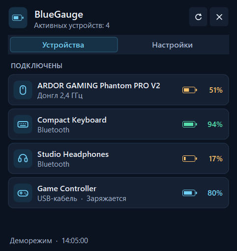

# BlueGauge

**Заряд Bluetooth-устройств и поддерживаемых мышей через USB-приёмник — рядом с часами Windows.**

[English](README.md) · [Лицензия MIT](LICENSE)

## Как пользоваться

Запусти **BlueGauge.exe**. Если значок оказался под стрелкой **^**, перетащи его к часам. На значке — минимальный известный заряд. В окне видны только устройства, которые сейчас передают заряд или статус зарядки. Список сопряжённых устройств не показывается. Крестик скрывает окно; для выхода выбери **Выход** в меню трея.

Можно настроить порог уведомлений, автозапуск и частоту опроса Bluetooth. Для USB-мышей опрос идёт каждые **2 секунды** независимо от Bluetooth-настроек. Поддерживаемый донгл может перестать отвечать, когда мышь выключена или спит; старый процент не выдаётся за новый.

| Модель | Подключение | Проверка |
| --- | --- | --- |
| ARDOR GAMING Phantom PRO V2 | Донгл 2,4 ГГц, 3554:F52D | Получен заряд с реальной мыши |
| ARDOR GAMING Phantom PRO V2 | USB-кабель, 3554:F52E | ID подтверждён конфигурацией фирменного ПО; чтение с кабеля не проверено |
| ARDOR GAMING Renegade | Донгл 2,4 ГГц, 25A7:FA4A | Реализовано по BatteryTray; физической проверки в BlueGauge не было. Процент с шагом 10% |
| Устройства Bluetooth Classic и BLE | Bluetooth | Только если Windows или устройство отдаёт заряд |

BlueGauge показывает процент из ответа донгла без округления и поправок. Если фирменная утилита показывает другое число, сравни оба показания несколько раз при активной мыши: время обновления и алгоритм отображения ARDOR не проверены. [Как проверить показания](docs/testing.md#comparing-with-the-ardor-utility).

Поддержка других приёмников ARDOR не подразумевается. Подписки, аккаунта и фирменной утилиты для опроса не нужно.

## Сборка

Приложение на .NET 11 для Windows 10 (сборка 19041 и новее) и Windows 11. В портативную x64-сборку уже включена среда .NET Desktop Runtime: устанавливать её отдельно не нужно. Для сборки исходников нужен SDK .NET 11 из `global.json`. Команды из корня проекта:

    .\scripts\build.ps1 -Test
    .\artifacts\win-x64\BlueGauge.exe --demo --ru

Сборка не подписана. Для проверки железа запусти скрипт с **-Live**. [Чек-лист](docs/testing.md) · [Сведения о BatteryTray](THIRD-PARTY-NOTICES.md).
